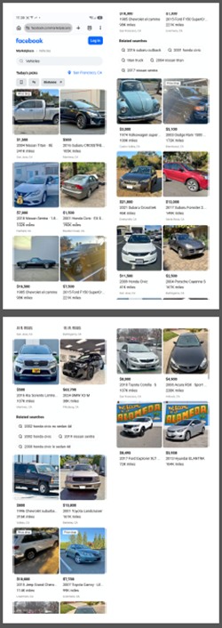
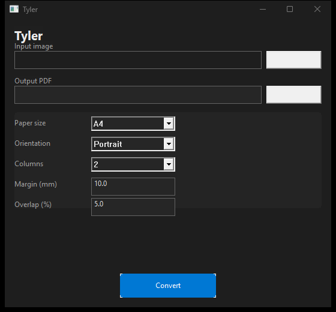

# Tyler

**Tyler — the image *Tiler* that turns very tall screenshots into printable, multi-column, multi-page PDFs.**

## What is Tyler?

Tyler takes a very tall screenshot or image (a long vertical strip), slices it into overlapping vertical strips, and lays them out column-by-column across pages — so a long screenshot is readable on paper without shrinking it to an illegible size. Instead of one extremely long page, you get a tidy multi-page PDF where each page holds several tiles side by side, and the whole conversation or image flows naturally from column to column and page to page.

The name is a pun: Tyler is a **Tiler** for screenshots.

## Features

- **Single native executable** built with .NET 10 **Native AOT** — no .NET runtime installation required.
- Ships with QuestPDF's support files (`qpdf.dll`, `QuestPdfSkia.dll`, `QuestPDF.Fonts.Lato.br`) — no system fonts required.
- **Cross-platform**: Windows and Linux, **x86, x64, and ARM64**.
- Powered by **SixLabors.ImageSharp** (image loading/slicing) and **QuestPDF** (PDF generation).
- Configurable **paper size** (A4 / Letter) and **orientation** (Portrait / Landscape).
- Configurable **columns per page**, **page margin**, and **vertical tile overlap** (to avoid losing content at tile seams).
- Overlapping slices ensure nothing is clipped between adjacent tiles.
- Deterministic, locale-independent CLI parsing (invariant culture).
- A native **Windows GUI** for point-and-click use on an interactive desktop.

## Sample

A long screenshot tiled into a printable multi-page PDF:

| Input | Output |
|-------|--------|
|  |  |

- Input: [`Sample/Screenshot.png`](Sample/Screenshot.png)
- Output: [`Sample/Screenshot.pdf`](Sample/Screenshot.pdf)

## Native Windows GUI

Running `Tyler` with **no arguments** on an interactive Windows desktop launches a modern, dark-themed native GUI built directly on the Win32 API (no WinForms/WPF/Avalonia):



### GUI vs. CLI dispatch

`Main` decides at startup based on the arguments and environment:

- **Any arguments provided** → the CLI pipeline runs.
- **No arguments + interactive Windows desktop with a display** (`Environment.UserInteractive` and at least one monitor) → the native GUI launches.
- **No arguments + headless session** (Windows service, Session 0, RDP disconnected, no display) or a **non-Windows** platform → the CLI `--help` screen is printed and the process exits `0`, so the tool stays safe to run unattended.

### GUI behaviors

- **Input browse + drag-and-drop** — pick an input image via the native file dialog, or drop an image onto the window to populate the input path.
- **Output auto-fill** — once an input is chosen, the output path automatically defaults to the same folder and filename with a `.pdf` extension.
- **Enum dropdowns** — choose the **paper size** (A4 / Letter) and **orientation** (Portrait / Landscape).
- **Numeric fields** — **margin** in millimetres and **overlap** as a percentage (0–100%).
- **Convert button** — runs the same [`TylerEngine`](src/Program.cs) pipeline (identical to the CLI) on a worker thread so the UI never freezes, then reports the result.

The GUI is built with raw Win32 + DWM + GDI via source-generated [`[LibraryImport]`](src/TylerGui.cs) P/Invokes, so it stays fully Native-AOT and trimming safe. It is Windows-only; on other platforms the CLI is used.

## Requirements / Build Prerequisites

- [.NET 10 SDK](https://dotnet.microsoft.com/download/dotnet/10.0)
- A C/C++ toolchain for Native AOT, per platform:
  - **Windows**: Visual Studio 2022 with the "Desktop development with C++" workload (MSVC).
  - **Linux**: `clang`, `zlib1g-dev` (see [Microsoft's Native AOT prerequisites](https://learn.microsoft.com/en-us/dotnet/core/deploying/native-aot/)).

## Build & Publish

The project lives at [`src/Tyler.csproj`](src/Tyler.csproj). Build with:

```bash
dotnet build src/Tyler.csproj -c Release
```

Publish a self-contained Native AOT executable for each target RID:

```bash
# Windows x64
dotnet publish src/Tyler.csproj -c Release -r win-x64

# Windows x86
dotnet publish src/Tyler.csproj -c Release -r win-x86

# Windows ARM64
dotnet publish src/Tyler.csproj -c Release -r win-arm64

# Linux x64
dotnet publish src/Tyler.csproj -c Release -r linux-x64

# Linux ARM64
dotnet publish src/Tyler.csproj -c Release -r linux-arm64
```

Output goes to `src/bin/Release/net10.0/<rid>/publish/`.

## Windows Installer (MSI)

A per-machine **Windows x64** MSI is built from the Native AOT publish output using the **WiX v3** toolset (`candle.exe` + `light.exe`). The WiX source is [`src/installer/Product.wxs`](src/installer/Product.wxs).

Build it with [`build-installer.ps1`](build-installer.ps1):

```powershell
# WiX v3 toolset must be installed (https://wixtoolset.org/releases/v3-11-1/).
.\build-installer.ps1 -WixPath "C:\Program Files (x86)\WiX Toolset v3.11\bin"
```

The script:

1. Publishes the app with `dotnet publish -c Release -r win-x64` (Native AOT → self-contained `Tyler.exe` + QuestPDF support files).
2. Runs `candle` + `light` on [`src/installer/Product.wxs`](src/installer/Product.wxs) with the publish directory and version baked in.
3. Produces `artifacts/Tyler-<version>-x64.msi` (the version is read from the published executable's `FileVersion`, falling back to `1.0.0`).

`-WixPath` points at the folder containing `candle.exe`/`light.exe`. If omitted, the script checks common install locations (WiX Toolset v3.11/3.14/3.10 under `C:\Program Files (x86)\`), then falls back to a `PATH` lookup — and raises a clear error if the toolset can't be found.

The resulting MSI:

- Is **per-machine** (`InstallScope="perMachine"`, `Platform="x64"`, installed into `Program Files`).
- Installs **Tyler + QuestPDF support files** (`Tyler.exe`, `qpdf.dll`, `QuestPdfSkia.dll`, `QuestPDF.Fonts.Lato.br`) and a **Start Menu shortcut**.
- **Upgrades cleanly** across releases via a stable `UpgradeCode` + `MajorUpgrade`.
- **Uninstalls completely** — `RemoveFolder` cleans up the install directory and Start Menu folder, leaving nothing behind.

## Deployment

Native AOT produces a single `Tyler` executable plus QuestPDF's support files, all in the publish directory:

```
Tyler
qpdf.dll
QuestPdfSkia.dll
QuestPDF.Fonts.Lato.br
```

No .NET runtime and no system fonts are required. Copy the whole publish directory to the target machine and run `Tyler` directly.

## CLI Usage

```
Tyler
Splits a long chat screenshot into a grid of tiles and lays them out on
multi-page PDF pages, filling columns top-to-bottom then left-to-right.

Usage:
  Tyler --input <image> --output <pdf> [options]

Arguments:
  --input <path>    (required) Path to the input image (PNG, JPEG or BMP).
  --output <path>   (required) Path of the generated multi-page PDF file.

Options:
  --paper-size <name>  A4 | Letter            (default: A4)
  --orientation <name> Portrait | Landscape   (default: Portrait)
  --columns <int>      Tiles per page          (default: 2, range 1..20)
  --margin <float>     Page margin in mm       (default: 10, must be >= 0)
  --overlap <float>    Vertical tile overlap % (default: 5, range 0..100)

Both '--name value' and '--name=value' forms are accepted. Flag names are
case-insensitive. Unknown arguments are rejected with a usage error.

Exit codes:
  0  success
  1  unexpected error
  2  usage / argument error
  3  structural / layout error (invalid image or geometry)
  4  I/O error (reading the input or writing the PDF)

Examples:
  Tyler --input chat.png --output chat.pdf
  Tyler --input=chat.png --output=chat.pdf
      --paper-size=Letter --orientation=Landscape --columns=3 --margin=8 --overlap=3
```

## License

Tyler is licensed under the [MIT License](LICENSE).

### Third-party notices

Tyler uses the following open-source libraries:

- **[SixLabors.ImageSharp](https://github.com/SixLabors/ImageSharp)** 3.1.12 — licensed under the **Six Labors Split License** (open-source for non-commercial use; commercial use requires a paid license from Six Labors).
- **[QuestPDF](https://www.questpdf.com/)** 2026.9.1 — licensed under the **QuestPDF Community License** (free for individuals and small businesses; larger organizations may require a paid license).

Please review each dependency's license terms before redistributing or using Tyler commercially.
